<div align="center">



<br/>


</div>

A tiny Markdown notes app that runs entirely in the browser. No build step, no dependencies.

## ✨ Features

| | Feature | Description |
|---|---|---|
| 📝 | **Live preview** | Headings, bold/italic, lists, quotes, code blocks and links |
| 🗂️ | **Multiple notes** | Keep as many notes as you like, with search |
| 💾 | **Auto-save** | Saved to your browser's localStorage as you type |
| 🌗 | **Light & dark mode** | Follows your system theme |
| 📱 | **Responsive** | Works on desktop and mobile |

<div align="center">


</div>

## 🚀 Run it

Just open `index.html` in a browser, or serve the folder:

```bash
python -m http.server 8000
# then visit http://localhost:8000
```

## 📁 Project structure

```text
.
├── index.html   # markup
├── style.css    # styles (light + dark)
├── app.js       # notes logic + Markdown rendering
└── assets/      # README graphics
```

## 🔒 Privacy

Your notes never leave your device.
